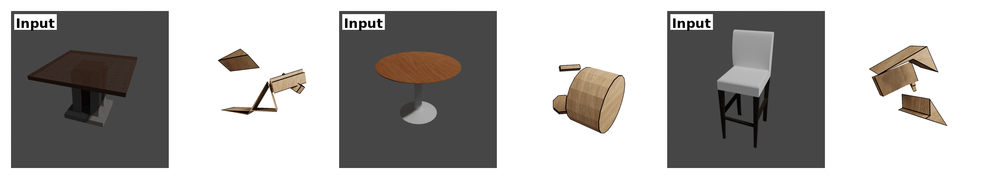

# (SIGGRAPH Asia 2025) Img2CAD: Reverse Engineering 3D CAD Models from Images

[](https://doi.org/10.1145/3757377.3763891)
[](https://arxiv.org/abs/2408.01437)
[](https://qq456cvb.github.io/projects/img2cad)
[](https://huggingface.co/qq456cvb/img2cad)
[](https://huggingface.co/datasets/qq456cvb/img2cad-dataset)
[](https://www.python.org/downloads/release/python-380/)
[](https://opensource.org/licenses/MIT)



> **Img2CAD: Reverse Engineering 3D CAD Models from Images through VLM-Assisted Conditional Factorization**  
> *Yang You, Mikaela Angelina Uy, Jiaqi Han, Rahul Thomas, Haotong Zhang, Yi Du, Hansheng Chen, Francis Engelmann, Suya You, Leonidas Guibas*  
> Stanford University, NVIDIA, Peking University, DEVCOM Army Research Laboratory

> Accepted to SIGGRAPH Asia 2025

## Overview

Img2CAD is a novel framework for reverse engineering 3D CAD models from single-view images. Our approach conditionally factorizes the complex image-to-CAD task into two manageable sub-problems:

1. **Discrete Structure Prediction**: Using finetuned Llama to predict the global discrete CAD command structure with semantic information
2. **Continuous Parameter Prediction**: Using TrAssembler, a transformer-based network, to predict continuous parameter values conditioned on the discrete structure


## 🏗️ Repository Structure

```
Img2CAD/
├── LlamaFT/                    # Fine-tuning code for discrete structure prediction
│   ├── finetune.py            # Fine-tuning script for Llama models
│   ├── infer.py               # Unified inference: images -> h5 files
│   └── prompt.txt             # Prompt template for VLM
├── TrAssembler/               # Continuous parameter prediction
│   ├── model.py               # TrAssembler model implementation
│   ├── dataset.py             # Dataset processing for TrAssembler
│   ├── train.py               # Training script for TrAssembler
│   ├── eval.py                # Evaluation script
│   └── config.yaml            # Configuration file
├── data/                      # Data directory (to be created)
│   ├── raw_annotated/         # Raw annotated CAD data
│   │   ├── chair/             # Chair category data
│   │   ├── table/             # Table category data
│   │   └── storagefurniture/  # Storage furniture data
│   ├── blender_renderings/    # Rendered images (.png files)
│   ├── sym_labels/            # Per-object symmetry labels (text files)
│   ├── llamaft_gt_labels/     # Ground truth labels for LlamaFT training
│   │   ├── chair/             # Text labels for chair category
│   │   ├── table/             # Text labels for table category
│   │   └── storagefurniture/  # Text labels for storage furniture
│   ├── splits/                # Train/test splits
│   │   ├── chair_train_ids.txt
│   │   ├── chair_test_ids.txt
│   │   └── ...
│   ├── partnet2common_*.json  # Part name mappings for each category
│   ├── *_mean_scale_stats.json # Statistical data for normalization
│   ├── output/                # Generated during inference
│   │   ├── llamaft_h5/        # H5 files from LlamaFT inference
│   │   └── trassembler_h5/    # Final output from TrAssembler
│   └── trassembler_data/      # Preprocessed data for TrAssembler
│       ├── chair_pkl/         # Processed chair data
│       ├── table_pkl/         # Processed table data
│       └── storagefurniture_pkl/
├── utils/                     # Utility functions
│   ├── cmd_to_vec.py          # CAD command to vector conversion
│   └── partseg.py             # Part segmentation evaluation module
├── cadlib/                    # CAD processing library
├── GMFlow/                    # Gaussian Mixture Flow submodule
└── requirements.txt           # All project dependencies
```

## 🚀 Quick Start

### Prerequisites

- Python 3.8+
- CUDA-compatible GPU
- 16GB+ RAM

### Installation

1. Clone the repository with all submodules:
```bash
git clone --recursive https://github.com/qq456cvb/Img2CAD.git
cd Img2CAD
```

If you've already cloned without submodules, initialize them:
```bash
git submodule update --init --recursive
```

2. Create and activate a virtual environment:
```bash
python -m venv img2cad_env
source img2cad_env/bin/activate  # On Windows: img2cad_env\Scripts\activate
```

3. Install all dependencies:
```bash
pip install -r requirements.txt
```

#### Linux Slurm server setup

The copied Windows environments (`img2cad_env` and `img2cad_conda`) cannot run
on Linux. Use `data/env-linux`. The steps below use this cluster's module names
and the supplied Slurm script. Run commands from the project root.

**1. Request a GPU session (each time you need a new allocation).**

On the login node (`submit02`):

```bash
cd /storage/work/ejh6103/Img2CAD
mkdir -p logs
sbatch tools/slurm-interactive.sbatch
squeue -u "$USER"
```

`sbatch` prints a job ID. Wait until its state is `R` (running); `PD` means
pending. Replace `YOUR_JOB_ID` below with that number:

```bash
srun --jobid=YOUR_JOB_ID --overlap --pty bash -l
```

You are now on the allocated compute node. Do not submit another job just because
the first is pending. If a job expires, request a new allocation.

**2. Configure your compute-node shell (every new session).**

```bash
cd /storage/work/ejh6103/Img2CAD
module load miniforge/25.3.0-3
module load gcc/9.1.0
```

For a fresh installation only, create the Linux environment now:

```bash
conda create -p "$PWD/data/env-linux" -c conda-forge python=3.10 pythonocc-core=7.8.1 pip -y
```

Then activate and configure it:

```bash
conda activate "$PWD/data/env-linux"
export CC="$(command -v gcc)"
export CXX="$(command -v g++)"
export CUDAHOSTCXX="$CXX"
export CUDA_HOME="$CONDA_PREFIX"
export TORCH_EXTENSIONS_DIR="$PWD/data/.cache/torch_extensions_linux"
export HF_HOME="$PWD/data/.cache/huggingface"
export MAX_JOBS=4
export TORCH_CUDA_ARCH_LIST="7.0"
nvidia-smi
"$CXX" --version
```

`7.0` targets the V100 requested by the supplied job script. GCC 9.1 meets the
PyTorch compiler requirement; the cluster's default compiler may be too old.
The exports select the compiler, CUDA toolkit, and persistent caches.

For a fresh installation only, install dependencies after configuring the shell:

```bash
bash tools/setup-linux.sh
```

The setup script installs the Linux requirements, CUDA 11.8, and GMFlow
requirements. It omits the unrelated PyPI `apex` package and adds CLIP and
flow-matching. Skip creation and installation if this environment already works.
Download the dataset and pretrained checkpoints using the sections below if they
are not already present.

**3. Authenticate once and check readiness.**

Obtain access to `meta-llama/Llama-3.2-11B-Vision-Instruct` on Hugging Face,
then log in with a read token. Keep the token private:

```bash
hf auth login
```

Authentication is saved under the configured Hugging Face home. On subsequent
sessions, keep the same `HF_HOME`; you normally do not need to log in again.
Run the readiness check on the compute node:

```bash
python tools/check-linux.py
```

Expect `passed` for CUDA rasterization, the CAD kernel, inference imports, and
Llama access. The report is saved in `logs/linux-readiness.json`. A successful
check verifies these components, but does not test the complete Stage 2 pipeline.

**4. Run inference.**

Start with one image and save the readable prediction alongside the HDF5 data:

```bash
python LlamaFT/infer.py --category chair --split test --max_samples 1 --save_text
ls -lh data/output/llamaft_h5/chair/*.h5
```

Stage 1 writes the discrete CAD structure. It overwrites matching `.h5` files;
`.txt` predictions are updated only with `--save_text`. A successful conversion
means the output could be written, not that its geometry is accurate.

Run Stage 2 to predict the continuous CAD parameters:

```bash
python TrAssembler/eval.py --model_dir data/ckpts/hf/trassembler/chair --text_emb_retrieval --skip_processed
```

Stage 2 reads Stage 1 predictions from `data/output/llamaft_h5/chair` and writes
to `data/output/trassembler_h5/chair`. An `.h5` file is structured binary data;
VS Code's text editor does not display it as a 3D model.

After the one-image pipeline works, process the full chair test split by omitting
`--max_samples`:

```bash
python LlamaFT/infer.py --category chair --split test --save_text
python TrAssembler/eval.py --model_dir data/ckpts/hf/trassembler/chair --text_emb_retrieval --skip_processed
```

Check time remaining before starting a full run. The current job lasts one hour,
including time spent setting up and downloading. To request more time for a new
job (subject to cluster limits), edit `#SBATCH --time` and the final `sleep`
duration in `tools/slurm-interactive.sbatch` together, then submit normally.
For two hours, use `#SBATCH --time=02:00:00` and `sleep 7200`.
The sleep keeps the interactive allocation alive; it must cover your session.

**Troubleshooting: `ModuleNotFoundError: No module named 'h5py'`.**

This can mean `python` is running outside the Linux project environment.
Activate it before running the README's Python commands:

```bash
module load miniforge/25.3.0-3
conda activate /storage/work/ejh6103/Img2CAD/data/env-linux
which python
python -c "import h5py; print(h5py.__version__)"
python LlamaFT/infer.py --category chair --split test --out_dir data/output/llamaft_h5/chair --save_text
```

`which python` should point inside `data/env-linux/bin`. If the import succeeds,
no reinstall is needed. Alternatively, the wrapper activates that environment:

```bash
bash tools/run-linux.sh LlamaFT/infer.py --category chair --split test --out_dir data/output/llamaft_h5/chair --save_text
```

Both inference commands process the full split. The wrapper does not replace the
compiler and `HF_HOME` setup in step 2.

**Making future inference runs faster.**

- Keep the persistent model cache and process multiple images in one invocation.
  Each new invocation loads the model again, even when no download is needed.
- Measure a few representative samples before a full run. The first tested
  sample took about 20 seconds for generation; 164 samples at that rate would
  take about 55 minutes, plus model loading. Actual times vary with output length.
- The current Stage 1 script processes one image at a time and has no batch-size
  option. Batching would require code changes and additional GPU memory; it is
  a future optimization to benchmark, not an existing command-line setting.
- A faster GPU is another option if available through your cluster. Benchmark
  before changing resource requests. Increasing CPU cores or system RAM alone
  does not guarantee faster GPU generation.
- If the script reports CPU offloading, some model layers run in system RAM.
  A GPU with sufficient memory may avoid that transfer overhead.
- `--num_tokens` is a maximum output length, not a fixed amount of work.
  Reducing it will not speed up outputs that already finish below the limit,
  and setting it too low can truncate the CAD description.
- Stage 1 currently overwrites existing predictions; it has no resume/skip flag.
  A future resume feature could avoid recomputing completed samples. Stage 2
  already supports `--skip_processed`.

**Model downloads and caching.**

The roughly 21 GB of Llama weights are downloaded to the Hugging Face cache on
first use. Keeping the same `HF_HOME` on shared storage allows later jobs to
reuse them. Each new Python process still loads the weights from disk into
memory; that is not another download. Deleting the cache, changing cache paths,
or selecting uncached model files can require downloads again. The cache uses
disk space, separate from RAM and GPU memory.

`bash tools/run-linux.sh SCRIPT [arguments]` is a convenience alternative to
`python SCRIPT [arguments]`: it activates the environment and sets CUDA and
extension-cache paths. Configure GCC and `HF_HOME` in your shell first as above.

**Allocated resources versus actual usage.**

`tools/slurm-interactive.sbatch` requests:

| Setting | Resource |
| --- | --- |
| `#SBATCH --cpus-per-task=4` | 4 allocated CPU cores |
| `#SBATCH --mem=64G` | 64 GB of system RAM for the job |
| `#SBATCH --gres=gpu:v100:1` | 1 V100 GPU (the tested node has 32 GB GPU memory) |
| `#SBATCH --time=01:00:00` | 1-hour allocation |
| `#SBATCH --account=open` | Allocation account |
| `#SBATCH --partition=standard` | Scheduling partition |

These are requests, not measurements of consumption. `MAX_JOBS=4` separately
limits parallel extension compilation workers; it does not request Slurm CPUs.
To inspect the allocation and time remaining:

```bash
scontrol show job YOUR_JOB_ID
squeue -j YOUR_JOB_ID -o "%.18i %.2t %.10M %.10L %.6D %R"
```

While inference is running, use another terminal connected to the same allocation
for monitoring:

```bash
nvidia-smi
ps -u "$USER" -o pid,pcpu,rss,etime,args --sort=-rss
sstat -j YOUR_JOB_ID --allsteps --format=JobID,AveCPU,AveRSS,MaxRSS
```

`nvidia-smi` shows GPU memory and utilization. In `ps`, `RSS` is resident system
RAM in KiB and `%CPU` is CPU utilization (100% is approximately one CPU core).
`sstat` provides Slurm accounting samples when enabled; `MaxRSS` is a sampled
per-task peak, not necessarily total job memory. After the job ends:

```bash
sacct -j YOUR_JOB_ID --format=JobID,State,Elapsed,AllocCPUS,ReqMem,MaxRSS,TotalCPU
```

To finish early and release the allocation, exit the compute-node shell and run
`scancel YOUR_JOB_ID` on the login node. Exiting the shell alone leaves the batch
script's sleep running until its time expires.

#### Native Windows CAD dependency

TrAssembler evaluation requires `pythonocc-core` (the `OCC` Python module).
The Windows binary distribution is installed with Conda; the pip virtual
environment above does not include it. From an Anaconda PowerShell prompt:

```powershell
conda create --prefix .\img2cad_conda --override-channels -c conda-forge python=3.12 pythonocc-core=7.8.1 numpy=1.26.2 pip
conda activate .\img2cad_conda
python -m pip install -r requirements-w.txt
```

If `data/windows-pip-migration.txt` exists, it records the packages from the
previous virtual environment and can be used to restore those versions:

```powershell
python -m pip install -r data/windows-pip-migration.txt
```

Use the Conda environment when running evaluation so the CAD DLLs can be found.
Alternatively, `tools/run_windows.py` runs Python in that environment:

```powershell
python tools/run_windows.py TrAssembler/eval.py --model_dir data/ckpts/trassembler/chair --text_emb_retrieval
```

Installing PythonOCC supplies the CAD library only. GMFlow dependencies and
CUDA compilation tools are also required for a complete evaluation run.

Install GMFlow's pinned Python dependencies in the Conda environment with:

```powershell
python -m pip install setuptools==80.9.0
python -m pip install --no-build-isolation -r requirements-gmflow-windows.txt
conda install --override-channels -c nvidia -c conda-forge cuda-nvcc=11.8 cuda-cudart=11.8 cuda-cudart-dev=11.8 cuda-cccl=11.8 cuda-version=11.8
conda install --override-channels -c nvidia -c conda-forge cuda-version=11.8 libcublas=11.11.3.6 libcublas-dev=11.11.3.6 libcusparse=11.7.5.86 libcusparse-dev=11.7.5.86 libcusolver=11.4.1.48 libcusolver-dev=11.4.1.48
```

CUDA 11.8 needs a compatible C++ compiler. In Visual Studio Installer, install
the individual component **MSVC v143 - VS 2022 C++ x64/x86 build tools (v14.38-17.8)**.
The Windows launcher selects this compiler and the environment-local CUDA Toolkit
and stores compiled extensions under `data/.cache/torch_extensions`.

### Pretrained Models

Download pretrained model checkpoints from Hugging Face:

```bash
# Download all models
hf download qq456cvb/img2cad --local-dir data/ckpts/hf

# Or download specific models
hf download qq456cvb/img2cad --include "llamaft/chair/*" --local-dir data/ckpts/hf
hf download qq456cvb/img2cad --include "trassembler/chair/*" --local-dir data/ckpts/hf
```

Available checkpoints:
| Model | Category | Path |
|-------|----------|------|
| LlamaFT | Chair | `llamaft/chair/` |
| LlamaFT | Table | `llamaft/table/` |
| LlamaFT | Storage Furniture | `llamaft/storagefurniture/` |
| TrAssembler | Chair | `trassembler/chair/` |
| TrAssembler | Table | `trassembler/table/` |
| TrAssembler | Storage Furniture | `trassembler/storagefurniture/` |
| PartSeg (PointNet2) | Chair | `partseg/chair/` |
| PartSeg (PointNet2) | Table | `partseg/table/` |
| PartSeg (PointNet2) | Storage Furniture | `partseg/storagefurniture/` |

### Dataset Setup

#### Option 1: Download from Hugging Face (Recommended)

```bash
# Install huggingface_hub if not already installed
pip install huggingface_hub

# Download the entire dataset
hf download qq456cvb/img2cad-dataset --repo-type dataset --local-dir data

# Or download specific directories
hf download qq456cvb/img2cad-dataset --repo-type dataset --include "raw_annotated/*" --local-dir data
hf download qq456cvb/img2cad-dataset --repo-type dataset --include "blender_renderings/*" --local-dir data
```

#### Option 2: Download from Google Drive

1. Download the raw annotated dataset to `data/raw_annotated/`
2. Download rendered images to `data/blender_renderings/`
3. Download ground truth labels for LlamaFT training to `data/llamaft_gt_labels/`
4. Download category-specific JSON files (part name mappings and statistics)
5. Download symmetry labels for each object to `data/sym_labels/`
6. Ensure train/test splits are in `data/splits/`

All datasets are also available at this [Google Drive link](https://drive.google.com/drive/folders/1HZYa5SF5Wt4f3iq6zNFaCXHUeKuF2p-D?usp=sharing).

Expected data structure:
```
data/
├── raw_annotated/
│   ├── chair/
│   │   ├── 12345/
│   │   │   ├── cad.h5
│   │   │   └── raw.obj
│   │   └── ...
│   ├── table/
│   └── storagefurniture/
├── blender_renderings/
│   ├── 12345.png
│   └── ...
├── sym_labels/
│   ├── 12345.txt              # 1=rotational, 2=reflection, 3=no_symmetry
│   └── ...
├── llamaft_gt_labels/
│   ├── chair/
│   │   ├── 12345.txt
│   │   └── ...
│   ├── table/
│   └── storagefurniture/
├── splits/
│   ├── chair_train_ids.txt
│   ├── chair_test_ids.txt
│   └── ...
├── partnet2common_chair.json
├── partnet2common_table.json
├── partnet2common_storagefurniture.json
├── chair_mean_scale_stats.json
├── table_mean_scale_stats.json
├── storagefurniture_mean_scale_stats.json
├── anno_id2model_id_chair.json      # Mapping from PartNet anno_id to ShapeNet model_id
├── anno_id2model_id_table.json
├── anno_id2model_id_storagefurniture.json
├── shapenet_partseg/                # Part segmentation annotations (unified txt format)
│   ├── synsetoffset2category.txt    # Category to synset mapping
│   ├── 03001627/                    # Chair annotations (*.txt files)
│   ├── 04379243/                    # Table annotations (*.txt files)
│   └── storagefurniture/            # Storagefurniture annotations (*.txt files)
├── ckpts/                           # Model checkpoints
│   ├── llamaft/
│   ├── trassembler/
│   └── partseg/                     # PointNet2 part segmentation checkpoints
│       ├── chair/best_model.pth
│       ├── table/best_model.pth
│       └── storagefurniture/best_model.pth
├── output/                          # Created during inference
│   ├── llamaft_h5/
│   │   ├── chair/
│   │   ├── table/
│   │   └── storagefurniture/
│   └── trassembler_h5/
└── trassembler_data/                # Created during dataset preparation
    ├── chair_pkl/
    ├── table_pkl/
    └── storagefurniture_pkl/
```
The **raw annotated `.h5` files** store the CAD command data for each object. The keys in each file correspond to the **part names** (e.g., `"leg"`, `"top"`, etc.), and if an object has only one part, the model still works seamlessly by feeding that single part into TrAssembler. Keys ending with `_bbox` represent the **3D bounding box** of the corresponding part. The values are **CAD parameters** following the DeepCAD convention: a 2D array where each row encodes a drawing command, such as `L, x, y`, representing a point on the line (polygon).


## 🎯 Usage

### Stage 1: Discrete Structure Prediction with LlamaFT

1. **Fine-tune the vision-language model (optional; skip when using pretrained adapters)**:
```bash
python LlamaFT/finetune.py --category chair --nepochs 10 --output_dir data/ckpts/llamaft
```

2. **Generate h5 files containing discrete structures from images**:
```bash
python LlamaFT/infer.py --category chair --split test --out_dir data/output/llamaft_h5/chair  # This will be used for the inference of TrAssembler
```

The pretrained LlamaFT checkpoints are adapters and also require access to
`meta-llama/Llama-3.2-11B-Vision-Instruct`. Authenticate with `hf auth login`
after obtaining access on the model's Hugging Face page. On GPUs with limited
memory, inference falls back to offloading token embeddings and the output head to CPU memory;
this can substantially increase generation time. Test with `--max_samples 1`
before processing a full split.

### Stage 2: Continuous Parameter Prediction with TrAssembler

1. **Prepare the dataset** (Optional):
```bash
python TrAssembler/dataset.py  # This will create data/trassembler_data/{category}_pkl directories
```
Or you can directly download our processed pickle data.

2. **Train TrAssembler**:
```bash
# Using default config
python TrAssembler/train.py --category chair

# With custom parameters
python TrAssembler/train.py --category chair --batch_size 16 --max_epochs 150 --lr 2e-4
```

3. **Evaluate the model**:
```bash
python TrAssembler/eval.py --model_dir data/ckpts/trassembler/chair --text_emb_retrieval
```

4. **Compute metrics only** (skip inference, use existing outputs):
```bash
python TrAssembler/eval.py --metrics_only --output_dir data/output/trassembler_h5/chair --category chair --eval_partseg  --text_emb_retrieval
```

## 📊 Configuration

### TrAssembler Configuration

The training can be customized using YAML configuration files:

- `config.yaml`: Base configuration

Key configuration options:

```yaml
# Dataset
category: chair  # chair, table, storagefurniture
batch_size: 8

# Training
max_epochs: 300
lr: 3e-4
weight_decay: 1e-2

# Model architecture
network:
  embed_dim: 64
  num_heads: 8
  dropout: 0.

# Gaussian Mixture Flow
gm:
  shift: 0.5
```

### LlamaFT Configuration

**Fine-tuning (finetune.py):**
- `--category`: Dataset category (chair, table, storagefurniture)
- `--nepochs`: Number of fine-tuning epochs
- `--output_dir`: Directory to save fine-tuned models

**Unified Inference (infer.py):**
- `--category`: Dataset category (default: chair)
- `--split`: Data split (default: test)
- `--img_dir`: Directory containing input images (default: data/blender_renderings)
- `--out_dir`: Directory to save h5 files (default: data/output/llamaft_h5/{category})
- `--adapter_path`: Path to fine-tuned adapter (auto-detected if not provided)
- `--num_tokens`: Max tokens per response (default: 1024)
- `--max_samples`: Limit processing to first N samples (for testing)
- `--save_text`: Save intermediate text responses for debugging
- `--hf_token`: Hugging Face authentication token

## 🔧 Evaluation Metrics

The evaluation script computes:
- **Chamfer Distance (CD)**: Geometric similarity to ground truth
- **Occupancy (OCC)**: Success rate of valid CAD model generation
- **Part Segmentation Accuracy**: Per-point part classification accuracy
- **Part mIoU**: Mean Intersection over Union for part segmentation

**Note:** The number of valid samples for part segmentation evaluation may be fewer than the total test set size, as multiple PartNet model IDs can correspond to the same ShapeNet model.


## 📝 Citation

If you find this work useful, please cite our paper:

```bibtex
@inproceedings{you2025img2cad,
  title={Img2CAD: Reverse Engineering 3D CAD Models from Images through VLM-Assisted Conditional Factorization},
  author={You, Yang and Uy, Mikaela Angelina and Han, Jiaqi and Thomas, Rahul and Zhang, Haotong and Du, Yi and Chen, Hansheng and Engelmann, Francis and You, Suya and Guibas, Leonidas},
  booktitle={Proceedings of the SIGGRAPH Asia 2025 Conference Papers},
  pages={1--12},
  year={2025},
  doi={10.1145/3757377.3763891}
}
```

## 📄 License

This project is licensed under the MIT License - see the [LICENSE](LICENSE) file for details.

## 🙏 Acknowledgments

- The authors thank the open-source community for their valuable tools and libraries, including [DeepCAD](https://github.com/rundiwu/DeepCAD) and [GMFlow](https://github.com/lakonik/gmflow).

## 📞 Contact

For questions or issues, please:
- Open an issue on GitHub
- Contact the authors: yangyou@stanford.edu

## 🔗 Links

- [Paper (arXiv)](https://arxiv.org/abs/2408.01437)
- [Paper (ACM)](https://doi.org/10.1145/3757377.3763891)
- [Project Page](https://qq456cvb.github.io/projects/img2cad)
- [Models (Hugging Face)](https://huggingface.co/qq456cvb/img2cad)
- [Dataset (Hugging Face)](https://huggingface.co/datasets/qq456cvb/img2cad-dataset)
- [Dataset (Google Drive)](https://drive.google.com/drive/folders/1HZYa5SF5Wt4f3iq6zNFaCXHUeKuF2p-D?usp=sharing)
